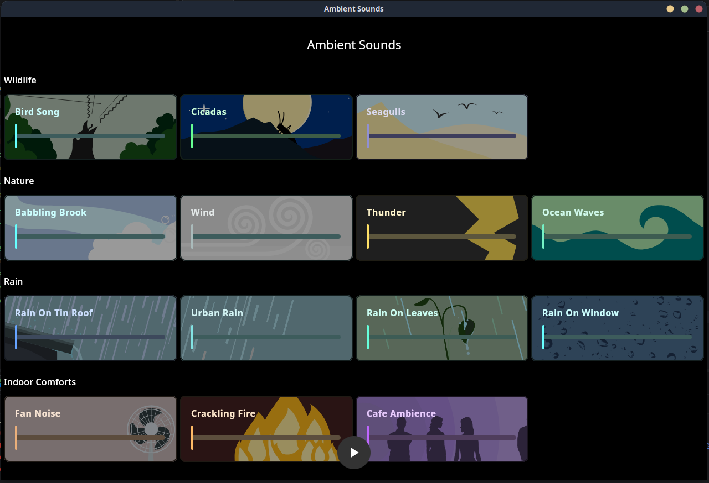
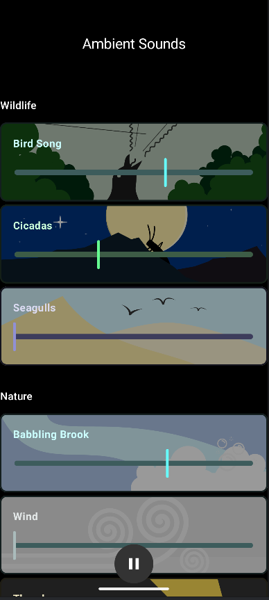
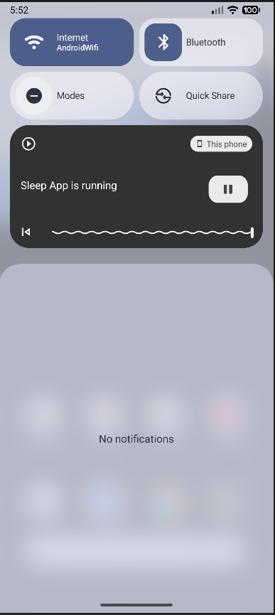

# Multi-Platform Ambient Sounds App
Some time ago, I used to rely heavily on an app that would let you layer up nice sounds to make a soothing ambience for sleep. After a while, it got filled with ads, and more and more features got pulled away until it was entirely paywalled - it gradually became a shadow of it's former self and I've missed it ever since.

**I like good sleep and you shouldn't have to pay for that. This app is staying free forever.**

Just load up the app, hit play and move the sliders around to make the overall soundscape you want. It supports background play so you can use it alongside other audio if needed and it's relatively simplistic so at this stage there's no special permissions needed. 

---


## Screenshots
### Desktop


### Mobile



---

## Support

**Tested on:** 
 - Android
 - Desktop
 - Web

\*IOS support us coming, but I need to get a dev environment set up first.

---

## Installing
Coming soon to the Play Store and other marketplaces - for now, getting it running is more of a manual process. 

### Android
You can download and install the APK. You'll likely need to enable software sources in order for your phone to allow the installation.
[Download APK](release/Ambient%20Sounds.apk)

### Manual Build
This is a Kotlin multiplatform (KMP) app so a lot of the docs surrounding KMP or composable will be helpful for custom builds. On Linux you can see build options by cloning into the repo and running: 
``` bash
./kotlin --help
```


To build on Android you will have to update the keystore information in: 
``` plaintext
ambient-sounds/androidApp/keystore.properties
```
and you can then do: 
``` bash
./kotlin build -p android -v release
```
or open the project in Android Studio and use the build options there.

---

## Thank You!
It's still early days for this project but I hope you like it!
I'll be adding to this where I can. 